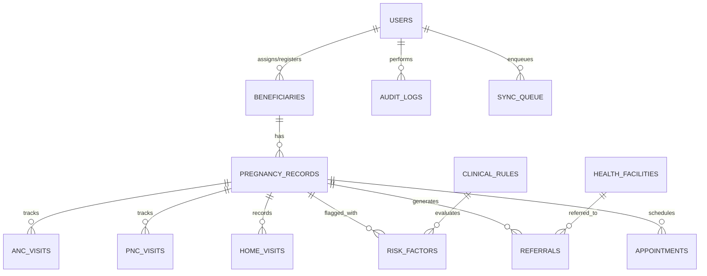

# ASHA Pregnancy Tracking System — Database Schema Design

The system uses a normalized relational schema with foreign key integrity, indexation, optimistic record versioning (`version_id`), and soft-deletion/status tracking.

## Table Specifications

### 1. `users`
- `id` (INTEGER, PK, AUTOINCREMENT)
- `username` (VARCHAR(64), UNIQUE, NOT NULL, INDEX)
- `password_hash` (VARCHAR(255), NOT NULL)
- `full_name` (VARCHAR(128), NOT NULL)
- `role` (VARCHAR(32), NOT NULL) - `ASHA`, `ANM`, `MEDICAL_OFFICER`, `SUPERVISOR`, `ADMIN`
- `phone_number` (VARCHAR(20))
- `village` (VARCHAR(100))
- `sub_centre` (VARCHAR(100))
- `preferred_language` (VARCHAR(10), DEFAULT 'ta') - 'ta', 'en'
- `is_active` (BOOLEAN, DEFAULT TRUE)
- `created_at` (DATETIME, NOT NULL)
- `updated_at` (DATETIME, NOT NULL)

### 2. `beneficiaries`
- `id` (INTEGER, PK, AUTOINCREMENT)
- `beneficiary_id` (VARCHAR(64), UNIQUE, NOT NULL, INDEX) - Stable synthetic internal ID (e.g., `BEN-2026-0001`)
- `full_name` (VARCHAR(128), NOT NULL)
- `age` (INTEGER, NOT NULL)
- `dob` (DATE)
- `contact_phone` (VARCHAR(20))
- `village` (VARCHAR(100), NOT NULL, INDEX)
- `sub_centre` (VARCHAR(100), NOT NULL, INDEX)
- `primary_health_centre` (VARCHAR(100))
- `assigned_asha_id` (INTEGER, FK -> users.id)
- `assigned_anm_id` (INTEGER, FK -> users.id)
- `preferred_language` (VARCHAR(10), DEFAULT 'ta')
- `consent_obtained` (BOOLEAN, DEFAULT TRUE)
- `privacy_notice_acknowledged` (BOOLEAN, DEFAULT TRUE)
- `is_active` (BOOLEAN, DEFAULT TRUE)
- `created_at` (DATETIME, NOT NULL)
- `updated_at` (DATETIME, NOT NULL)
- `version_id` (INTEGER, DEFAULT 1)

### 3. `pregnancy_records`
- `id` (INTEGER, PK, AUTOINCREMENT)
- `pregnancy_id` (VARCHAR(64), UNIQUE, NOT NULL, INDEX) - e.g. `PRG-2026-0001`
- `beneficiary_id` (VARCHAR(64), FK -> beneficiaries.beneficiary_id, NOT NULL, INDEX)
- `gravida` (INTEGER, DEFAULT 1) - Pregnancy count
- `parity` (INTEGER, DEFAULT 0) - Birth count
- `lmp_date` (DATE) - Last Menstrual Period
- `edd_date` (DATE) - Estimated Date of Delivery (LMP + 280 days if LMP reliable)
- `is_edd_estimated` (BOOLEAN, DEFAULT TRUE)
- `confirmation_date` (DATE)
- `registration_date` (DATE, NOT NULL)
- `status` (VARCHAR(32), NOT NULL, DEFAULT 'ACTIVE') - `ACTIVE`, `DELIVERED`, `TRANSFERRED`, `CLOSED`
- `past_obstetric_history` (TEXT)
- `known_medical_conditions` (TEXT)
- `high_risk_flag` (BOOLEAN, DEFAULT FALSE, INDEX)
- `assigned_facility_id` (INTEGER, FK -> health_facilities.id)
- `created_at` (DATETIME, NOT NULL)
- `updated_at` (DATETIME, NOT NULL)
- `version_id` (INTEGER, DEFAULT 1)

### 4. `anc_visits`
- `id` (INTEGER, PK, AUTOINCREMENT)
- `visit_uuid` (VARCHAR(64), UNIQUE, NOT NULL, INDEX)
- `pregnancy_id` (VARCHAR(64), FK -> pregnancy_records.pregnancy_id, NOT NULL, INDEX)
- `beneficiary_id` (VARCHAR(64), NOT NULL)
- `anc_period` (VARCHAR(20), NOT NULL) - `ANC-1` (Up to 12 weeks), `ANC-2` (14-26 weeks), `ANC-3` (28-34 weeks), `ANC-4` (36-40 weeks)
- `scheduled_date` (DATE, NOT NULL)
- `actual_visit_date` (DATE)
- `status` (VARCHAR(32), NOT NULL) - `NOT_YET_DUE`, `DUE_SOON`, `DUE`, `COMPLETED`, `OVERDUE`, `DEFERRED`, `UNKNOWN`
- `gestational_age_weeks` (INTEGER)
- `recorded_by_user_id` (INTEGER, FK -> users.id)
- `weight_kg` (FLOAT)
- `bp_systolic` (INTEGER)
- `bp_diastolic` (INTEGER)
- `hemoglobin_g_dl` (FLOAT)
- `urine_albumin` (VARCHAR(32)) - `NIL`, `TRACE`, `PRESENT`, `NOT_DONE`
- `urine_sugar` (VARCHAR(32)) - `NIL`, `PRESENT`, `NOT_DONE`
- `ultrasound_status` (VARCHAR(64))
- `ifa_tablets_issued` (INTEGER, DEFAULT 0)
- `calcium_tablets_issued` (INTEGER, DEFAULT 0)
- `tt_td_dose` (VARCHAR(32)) - `TD_1`, `TD_2`, `TD_BOOSTER`, `NONE`
- `counselling_topics` (TEXT) - e.g. Nutrition, Birth Preparedness, Danger Signs
- `deferral_reason` (TEXT)
- `clinical_notes` (TEXT)
- `sync_status` (VARCHAR(32), DEFAULT 'SYNCHRONIZED')
- `created_at` (DATETIME, NOT NULL)
- `updated_at` (DATETIME, NOT NULL)
- `version_id` (INTEGER, DEFAULT 1)

### 5. `clinical_rules`
- `id` (INTEGER, PK, AUTOINCREMENT)
- `rule_code` (VARCHAR(64), UNIQUE, NOT NULL) - e.g. `RULE-HRP-BP-001`, `RULE-HRP-HB-002`
- `rule_name` (VARCHAR(128), NOT NULL)
- `description` (TEXT, NOT NULL)
- `approved_source` (VARCHAR(128), NOT NULL) - e.g. "MoHFW Guidelines for High Risk Pregnancy 2024"
- `version_number` (VARCHAR(32), NOT NULL) - e.g. "2.1.0"
- `effective_date` (DATE, NOT NULL)
- `review_date` (DATE, NOT NULL)
- `authorized_approver` (VARCHAR(128), NOT NULL) - e.g. "State Maternal Health Technical Committee"
- `is_active` (BOOLEAN, DEFAULT TRUE)

### 6. `risk_factors`
- `id` (INTEGER, PK, AUTOINCREMENT)
- `risk_uuid` (VARCHAR(64), UNIQUE, NOT NULL, INDEX)
- `pregnancy_id` (VARCHAR(64), FK -> pregnancy_records.pregnancy_id, NOT NULL, INDEX)
- `rule_code` (VARCHAR(64), FK -> clinical_rules.rule_code)
- `risk_title` (VARCHAR(128), NOT NULL)
- `risk_detail` (TEXT)
- `severity` (VARCHAR(32), NOT NULL) - `MODERATE`, `HIGH`, `EMERGENCY`
- `status` (VARCHAR(32), NOT NULL) - `REPORTED`, `RULE_FLAGGED`, `ASSESSMENT_PENDING`, `CONFIRMED_HIGH_RISK`, `FOLLOW_UP_COMPLETED`, `RESOLVED`
- `requires_professional_review` (BOOLEAN, DEFAULT TRUE)
- `recorded_by_user_id` (INTEGER, FK -> users.id)
- `confirmed_by_doctor_id` (INTEGER, FK -> users.id)
- `follow_up_due_date` (DATE)
- `created_at` (DATETIME, NOT NULL)
- `updated_at` (DATETIME, NOT NULL)

### 7. `danger_signs_catalog`
- `id` (INTEGER, PK, AUTOINCREMENT)
- `symptom_code` (VARCHAR(64), UNIQUE, NOT NULL)
- `symptom_name_en` (VARCHAR(128), NOT NULL)
- `symptom_name_ta` (VARCHAR(128), NOT NULL)
- `applicable_stage` (VARCHAR(32), NOT NULL) - `PREGNANCY`, `LABOUR`, `POSTPARTUM`
- `urgency_level` (VARCHAR(32), NOT NULL) - `URGENT_EMERGENCY`, `PRIORITY_REFERRAL`
- `approved_response_en` (TEXT, NOT NULL)
- `approved_response_ta` (TEXT, NOT NULL)
- `source_guideline` (VARCHAR(128), NOT NULL)
- `guideline_version` (VARCHAR(32), NOT NULL)

### 8. `referrals`
- `id` (INTEGER, PK, AUTOINCREMENT)
- `referral_uuid` (VARCHAR(64), UNIQUE, NOT NULL, INDEX)
- `pregnancy_id` (VARCHAR(64), FK -> pregnancy_records.pregnancy_id, NOT NULL, INDEX)
- `beneficiary_id` (VARCHAR(64), NOT NULL)
- `danger_sign_code` (VARCHAR(64))
- `reason` (TEXT, NOT NULL)
- `urgency` (VARCHAR(32), NOT NULL) - `CRITICAL_108`, `HIGH_PRIORITY_102`, `ROUTINE`
- `referring_user_id` (INTEGER, FK -> users.id, NOT NULL)
- `destination_facility_id` (INTEGER, FK -> health_facilities.id, NOT NULL)
- `referral_initiated_at` (DATETIME, NOT NULL)
- `transport_mode` (VARCHAR(64)) - `EMERGENCY_AMBULANCE_108`, `JANANI_EXPRESS_102`, `PRIVATE_VEHICLE`
- `facility_acknowledged` (BOOLEAN, DEFAULT FALSE)
- `acknowledgement_time` (DATETIME)
- `outcome_status` (VARCHAR(32), DEFAULT 'PENDING') - `PENDING`, `ADMITTED`, `TREATED_DISCHARGED`, `ESCALATED_TERTIARY`, `LOST_TO_FOLLOWUP`
- `outcome_notes` (TEXT)
- `is_resolved` (BOOLEAN, DEFAULT FALSE, INDEX)
- `created_at` (DATETIME, NOT NULL)
- `updated_at` (DATETIME, NOT NULL)

### 9. `pnc_visits`
- `id` (INTEGER, PK, AUTOINCREMENT)
- `pnc_uuid` (VARCHAR(64), UNIQUE, NOT NULL, INDEX)
- `pregnancy_id` (VARCHAR(64), FK -> pregnancy_records.pregnancy_id, NOT NULL, INDEX)
- `beneficiary_id` (VARCHAR(64), NOT NULL)
- `pnc_interval` (VARCHAR(32), NOT NULL) - `DAY_1`, `DAY_3`, `DAY_7`, `DAY_14`, `DAY_21`, `DAY_28`, `DAY_42`
- `delivery_date` (DATE)
- `delivery_facility` (VARCHAR(128))
- `scheduled_date` (DATE, NOT NULL)
- `actual_visit_date` (DATE)
- `status` (VARCHAR(32), NOT NULL) - `NOT_YET_DUE`, `DUE_SOON`, `DUE`, `COMPLETED`, `OVERDUE`
- `maternal_assessment_status` (TEXT)
- `newborn_follow_up_status` (TEXT)
- `feeding_counselling_provided` (BOOLEAN, DEFAULT TRUE)
- `danger_signs_reported` (TEXT)
- `referral_initiated` (BOOLEAN, DEFAULT FALSE)
- `recorded_by_user_id` (INTEGER, FK -> users.id)
- `created_at` (DATETIME, NOT NULL)
- `updated_at` (DATETIME, NOT NULL)

### 10. `home_visits`
- `id` (INTEGER, PK, AUTOINCREMENT)
- `visit_uuid` (VARCHAR(64), UNIQUE, NOT NULL, INDEX)
- `pregnancy_id` (VARCHAR(64), FK -> pregnancy_records.pregnancy_id, NOT NULL, INDEX)
- `beneficiary_id` (VARCHAR(64), NOT NULL)
- `visit_date` (DATE, NOT NULL)
- `assigned_worker_id` (INTEGER, FK -> users.id, NOT NULL)
- `visit_purpose` (VARCHAR(128), NOT NULL) - `ROUTINE_PREGNANCY_SURVEILLANCE`, `HIGH_RISK_FOLLOWUP`, `MISSED_ANC_RECOVERY`, `POSTPARTUM_CHECK`
- `is_completed` (BOOLEAN, DEFAULT FALSE)
- `observations` (TEXT)
- `counselling_topics` (TEXT)
- `follow_up_tasks` (TEXT)
- `referral_initiated` (BOOLEAN, DEFAULT FALSE)
- `next_visit_date` (DATE)
- `notes` (TEXT)
- `is_draft` (BOOLEAN, DEFAULT FALSE)
- `sync_status` (VARCHAR(32), DEFAULT 'SYNCHRONIZED')
- `created_at` (DATETIME, NOT NULL)
- `updated_at` (DATETIME, NOT NULL)

### 11. `health_facilities`
- `id` (INTEGER, PK, AUTOINCREMENT)
- `facility_code` (VARCHAR(64), UNIQUE, NOT NULL)
- `facility_name` (VARCHAR(128), NOT NULL)
- `facility_type` (VARCHAR(64), NOT NULL) - `SUB_CENTRE`, `PHC`, `CHC`, `SUB_DISTRICT_HOSPITAL`, `DISTRICT_HEADQUARTERS_HOSPITAL`, `MEDICAL_COLLEGE`
- `district` (VARCHAR(100), NOT NULL)
- `block` (VARCHAR(100), NOT NULL)
- `emergency_phone_1` (VARCHAR(20), NOT NULL) - e.g. 108 / Facility Casualty
- `emergency_phone_2` (VARCHAR(20))
- `is_frusc` (BOOLEAN, DEFAULT FALSE) - First Referral Unit status
- `has_c_section` (BOOLEAN, DEFAULT FALSE)
- `has_blood_bank` (BOOLEAN, DEFAULT FALSE)

### 12. `sync_queue`
- `id` (INTEGER, PK, AUTOINCREMENT)
- `client_tx_id` (VARCHAR(64), UNIQUE, NOT NULL, INDEX)
- `user_id` (INTEGER, FK -> users.id, NOT NULL)
- `entity_type` (VARCHAR(64), NOT NULL) - `beneficiary`, `pregnancy`, `anc_visit`, `risk_factor`, `referral`, `home_visit`
- `operation` (VARCHAR(32), NOT NULL) - `CREATE`, `UPDATE`
- `client_version` (INTEGER, NOT NULL)
- `payload_json` (TEXT, NOT NULL)
- `sync_state` (VARCHAR(32), NOT NULL) - `WAITING_TO_SYNC`, `SYNCHRONIZED`, `CONFLICT_REQUIRES_REVIEW`, `SYNCHRONIZATION_FAILED`
- `server_acknowledged_at` (DATETIME)
- `conflict_details` (TEXT)
- `created_at` (DATETIME, NOT NULL)
- `retry_count` (INTEGER, DEFAULT 0)

### 13. `audit_logs`
- `id` (INTEGER, PK, AUTOINCREMENT)
- `timestamp` (DATETIME, NOT NULL, INDEX)
- `user_id` (INTEGER, FK -> users.id)
- `username` (VARCHAR(64))
- `user_role` (VARCHAR(32))
- `action` (VARCHAR(64), NOT NULL) - `LOGIN`, `VIEW_BENEFICIARY`, `CREATE_BENEFICIARY`, `UPDATE_ANC`, `FLAG_HIGH_RISK`, `EMERGENCY_REFERRAL`, `EXPORT_REPORT`
- `target_entity` (VARCHAR(64))
- `target_id` (VARCHAR(64))
- `details` (TEXT)
- `ip_address` (VARCHAR(64))

### 14. `knowledge_documents`
- `id` (INTEGER, PK, AUTOINCREMENT)
- `document_code` (VARCHAR(64), UNIQUE, NOT NULL)
- `title` (VARCHAR(255), NOT NULL)
- `organization` (VARCHAR(128), NOT NULL) - MoHFW, NHM, TNHSP
- `version` (VARCHAR(32), NOT NULL)
- `publication_date` (DATE)
- `content_json` (TEXT, NOT NULL)
- `is_approved` (BOOLEAN, DEFAULT TRUE)

