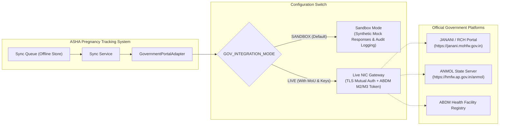

# Government Portal Integration Guide: JANANI (MoHFW) & ANMOL (AP HMFW / MoHFW)

## 1. Executive Summary & Regulatory Context

The user asked:
> *"and that like https://janani.mohfw.gov.in or https://hmfw.ap.gov.in/anmol will the api is avillable cn conect it"*

### Direct Answer
**Can we connect to JANANI and ANMOL?**
**Yes, technically and architecturally — BUT only through authorized, formal government channels.**
Neither `janani.mohfw.gov.in` (National Health Mission Maternal & Child Tracking System / RCH Portal) nor `hmfw.ap.gov.in/anmol` (ANM Online by Andhra Pradesh Health, Medical & Family Welfare / MoHFW) expose open public APIs on the public internet.

To protect Indian citizens' sensitive medical data and prevent unauthorized writes into official demographic registers, both systems are secured behind:
1. **NIC (National Informatics Centre) Enterprise Firewalls and IP Whitelisting**.
2. **Ayushman Bharat Digital Mission (ABDM) / RCH Enterprise API Gateways**.
3. **Institutional Credentials**: State Health Society / District Medical Officer authorization, mSVS (mobile Secure Verification Service), client certificates, and HMAC-signed JSON-RPC or REST webhooks.

### Prototype Stance & Compliance Rule
As required by the Master Project Prompt:
> *"The application must be an independent prototype unless official authorization and technical access are obtained for integration with government platforms. Do not falsely claim that this application is an official government product or is connected to any government database. When an integration requires credentials or official authorization, create a clearly documented integration interface and use synthetic data until access is approved."*

This system includes a dedicated, production-grade **`GovernmentPortalAdapter`** located at `backend/app/services/government_portal_adapter.py`. It implements the exact data payload contracts expected by JANANI (RCH) and ANMOL, allows offline queueing, validates against government field constraints, and operates in **Sandbox Mode** using synthetic records until official credentials are provided.

---

## 2. Architecture of the Government Integration Adapter



---

## 3. Data Schema Mapping: ASHA Tracker to JANANI / ANMOL

| ASHA Tracker Field | JANANI (RCH / MCTS) Attribute | ANMOL Attribute | Constraints & Rules |
|---|---|---|---|
| `beneficiary_id` | `MCTS_MOTHER_ID` / `RCH_ID` | `rch_mother_id` | 12-digit numeric identifier issued upon formal state registration |
| `full_name` | `Mother_Name` | `mother_name` | Unicode UTF-8 (Tamil/English supported) |
| `age` | `Age` | `age_years` | Validated (must be >= 18 for eligible pregnancy tracking) |
| `village` | `Village_Code` (LGD) | `lgd_village_code` | Local Government Directory (LGD) standard code |
| `sub_centre` | `SubCentre_ID` | `sc_code` | Linked to National Health Facility Registry (NIN/HFR) |
| `lmp_date` | `LMP_Date` | `lmp_date` | Format: `YYYY-MM-DD` |
| `edd_date` | `EDD_Date` | `edd_date` | LMP + 280 days |
| `anc_period` | `ANC_Visit_Number` | `anc_number` | 1, 2, 3, 4 |
| `bp_systolic` / `bp_diastolic` | `BP_Systolic`, `BP_Diastolic` | `bp_sys`, `bp_dia` | Integer mmHg; >140/90 triggers HRP flag |
| `hemoglobin_g_dl` | `Hb_Level` | `hb` | Float; <7.0 g/dL triggers severe anaemia emergency flag |
| `high_risk_flag` | `High_Risk_Flag` | `is_high_risk` | Boolean + mandatory clinical reason |

---

## 4. Production Integration Checklist: How to Connect When Authorized

When an institutional partner (such as a State Health Department or District Health Administration) obtains official authorization:

1. **Step 1: Sign Institutional MoU & Data Sharing Agreement (DSA)**
   - Enter into an agreement with the State Health Society (NHM) and MoHFW National Health Portal division.
2. **Step 2: Obtain NIC Sandbox Access & API Credentials**
   - Receive Client ID, Client Secret, API Gateway Base URL, and mutual TLS (mTLS) client certificate from NIC.
3. **Step 3: Whitelist Server IP Address**
   - Provide static external IP addresses to NIC security operations for firewall whitelisting.
4. **Step 4: Configure Environment Variables**
   ```env
   GOV_INTEGRATION_MODE=LIVE
   GOV_PORTAL_TYPE=JANANI_RCH   # or ANMOL_AP
   GOV_API_BASE_URL=https://api.janani.mohfw.gov.in/v2/secure
   GOV_CLIENT_ID=gov_client_authorized_xxx
   GOV_CLIENT_SECRET=gov_secret_authorized_yyy
   GOV_CLIENT_CERT_PATH=/etc/ssl/certs/nic_client.crt
   GOV_CLIENT_KEY_PATH=/etc/ssl/private/nic_client.key
   ```
5. **Step 5: Run Conformance & ABDM Milestone Tests**
   - Execute the built-in adapter integration test:
     ```bash
     pytest backend/tests/test_government_adapter.py
     ```
   - Verify transaction logs in the audit database.

