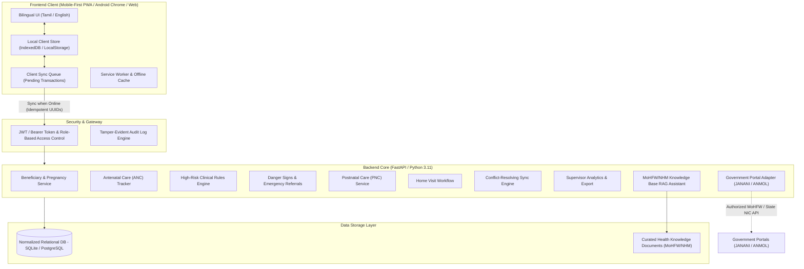

# ASHA Pregnancy Tracking System — System Architecture

## 1. Overview and High-Level Architecture

The ASHA Pregnancy Tracking System is an offline-first, safety-first maternal healthcare management system designed specifically for Accredited Social Health Activists (ASHAs), Auxiliary Nurse Midwives (ANMs), Medical Officers (MOs), and Program Supervisors in India.

---

## 2. Role-Based Access Control (RBAC) Matrix

| Feature / Capability | ASHA Worker | ANM / Staff Nurse | Medical Officer | Supervisor | System Administrator |
|---|:---:|:---:|:---:|:---:|:---:|
| Register Beneficiaries | Yes | Yes | Yes | Read-Only | System Config Only |
| Record Home Visits & Notes | Yes | Yes | Yes | Read-Only | Audit Log Only |
| Record ANC/PNC Checkups | Routine checklist | Full Clinical checks | Full Clinical | Aggregates | Audit Log Only |
| Record High-Risk Symptoms | Flag/Report | Confirm & Plan | Clinical Decision | Monitor List | Audit Log Only |
| Initiate Emergency Referral | Yes | Yes | Yes | Monitor List | Audit Log Only |
| Validate / Clear Referral | No | Yes | Yes | Review status | Audit Log Only |
| View Supervisor KPI Dashboard | Assigned Area | Assigned SC | Assigned PHC | Full Block/District | System Health |
| User & Assignment Admin | No | No | No | No | Full Control |
| Access Knowledge RAG Assistant | Yes | Yes | Yes | Yes | Yes |

*Note: System Administrators do not receive unrestricted medical access without clinical authorization.*

---

## 3. Offline-First Architecture & Synchronization Engine

1. **Local-First Writes**: Every action (beneficiary registration, ANC visit, danger sign, home visit) is saved locally to IndexedDB/Client store immediately with a unique client transaction ID (`client_uuid`), creation timestamp, and payload.
2. **Sync States**:
   - `SAVED_LOCALLY`: Written to device storage, awaiting connectivity.
   - `WAITING_TO_SYNC`: Enqueued in persistent sync queue.
   - `SYNCHRONIZING`: Active upload/download in progress.
   - `SYNCHRONIZED`: Server acknowledged with server timestamp and confirmed record version.
   - `CONFLICT_REQUIRES_REVIEW`: Version discrepancy or concurrent update detected.
   - `SYNCHRONIZATION_FAILED`: Network failure or schema validation failure with automatic exponential retry.
3. **Conflict Resolution Policy**:
   - High-risk / danger-sign records: Never silently overwritten. Merged additively so no danger sign is ever dropped.
   - Clinical measurements: ANM/Doctor record supersedes unvalidated field measurements.
   - Profile updates: Last modified with change audit log, keeping previous state intact in the audit trail.

